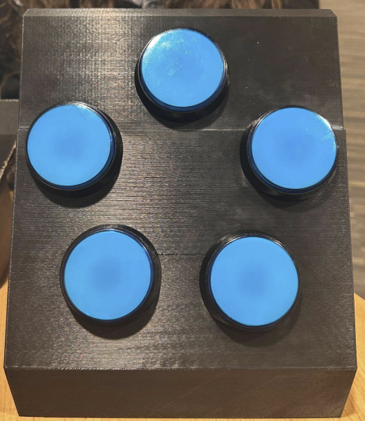
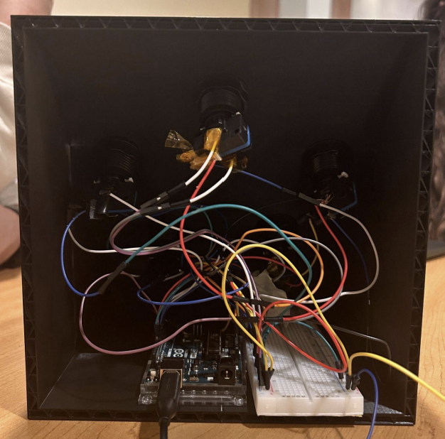

# Athlete Reaction Time Training System

A physical reaction time training prototype developed by a four person team for ENGR 107 at George Mason University.

## Overview

The prototype uses five illuminated push buttons to challenge a user's reaction speed. An Arduino randomly lights one button at a time and measures how quickly the athlete presses it. The Arduino sends the measurements to a laptop running MATLAB, which displays reaction time data in real time.

## Project Demonstration

[Watch the project demonstration on YouTube](https://youtube.com/shorts/u9jBQwLyl9Y?is=vNQ3g0TEdtuMYS1n)

## Final Product

### Front View

### Back View

## My Contribution

My primary contribution was assembling the Arduino hardware and helping connect the physical components into the working prototype.

The project was completed as a team. Other contributions included 3D modeling and printing, programming, and project documentation.

## System Components

- Five illuminated push buttons
- Arduino based hardware assembly
- Laptop running MATLAB
- Serial communication between the Arduino and MATLAB
- Real time plotting of reaction time data

## Software

The original project source code is no longer available. The Arduino and MATLAB files in this repository are reconstructed implementations based on the system's documented functionality. They are included as examples for reference and may differ from the software used in the original prototype.

- [Arduino code](software/arduino/reaction_sensor.ino): controls the five buttons and LEDs, measures reaction times, and sends results over serial communication.
- [MATLAB code](software/matlab/reaction_plot.m): receives measurements, plots reaction time in real time, calculates the average and best reaction times, and saves results to a CSV file.

The Arduino runs 20 rounds per session. MATLAB communicates with it at 115200 baud.

### Running the Software

1. Upload the Arduino sketch to the board using the Arduino IDE.
2. Open the MATLAB script.
3. Change the `port` value in the MATLAB script to match the serial port used by your Arduino.
4. Run the MATLAB script to start a session.
5. The system records 20 reaction time trials and saves the results as `reaction_results.csv`.

The MATLAB script requires MATLAB R2019b or newer because it uses `serialport`.

